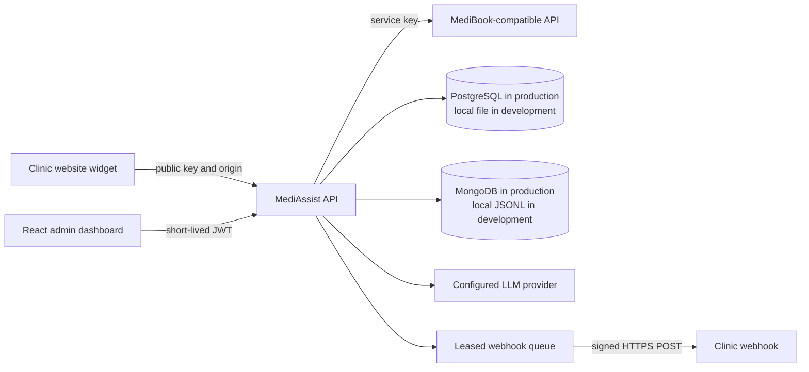

# MediAssist AI

MediAssist AI is a single-clinic operations and integrations workspace. It connects a patient-facing booking widget and React admin dashboard through an Express API, with workflows for appointments, SOAP note drafts, event automations, and signed webhook delivery. A MediBook-compatible mock and deterministic local LLM provider make the end-to-end demo runnable without Docker, a database, or third-party API credentials.

The deployment boundary is one clinic per installation; multi-tenant SaaS isolation is not implemented.

> **Safety note:** This repository is software, not a clinical service or compliance certification. Redaction is best-effort and generated notes require clinician review. Do not use real patient data until security, privacy, legal, provider-contract, and operational reviews are complete.

## Product capabilities

- **Patient booking:** an embeddable widget lets patients browse available slots and submit bookings. The browser calls MediAssist’s public API; the MediBook service credential stays on the server.
- **Staff operations:** the React dashboard supports booking and visit-note workflows. Administrators manage team access, widget keys, prompts, automations, webhooks, and operational logs.
- **AI-assisted visit notes:** sample text is redacted on a best-effort basis before a structured SOAP draft is generated. The local deterministic provider requires no API key; a clinician must review every draft.
- **Event automations:** signed event receipts and idempotency checks prevent duplicate processing, while sensitive fields are excluded from automation inputs.
- **Resilient webhook delivery:** durable leases, signed HTTPS requests, retries, replay controls, DNS validation, and correlation IDs make failures visible and recoverable.
- **Runnable integration boundary:** the included MediBook-compatible mock lets the booking flow run locally without a real clinic system or provider credentials.

## Run locally without Docker

Requirements: Node.js 22.x or 24.x and pnpm 11.

```powershell
Copy-Item .env.example .env
pnpm install
pnpm dev
```

The default uses local file storage and the in-memory MediBook mock. It does not need PostgreSQL, MongoDB, or an LLM key.

| Surface | Local address | Purpose |
|---|---|---|
| Admin dashboard | `http://localhost:5173` | Clinic staff booking, notes, automations, and operations |
| Widget demo | `http://localhost:5174` | Patient booking flow on a separate origin |
| API and OpenAPI page | `http://localhost:4000/docs` | MediAssist REST API and interactive API description |
| MediBook mock | `http://localhost:4100/health` | Local booking service used by the integration demo |

Demo sign-in is `admin@mediassist.local` / `change-this-demo-password`. The local widget key is `pk_test_mediassist` and only allows the local dashboard and demo origins. The mock resets its appointments when restarted. Local state and logs are stored in `server/.data/` and ignored by Git.

## Demo flow

1. Open the demo on port 5174 and book an available weekday slot.
2. Open the dashboard and inspect Bookings, Automations, and Log Viewer.
3. In Webhook Sandbox, create an endpoint in `500` mode, send a test, change it to `ok`, and watch the retry or replay.
4. In Visit Notes, paste sample text and inspect the redacted text and structured SOAP draft. The local deterministic provider needs no API key.

## Architecture



## Repository structure and stack

| Path | Responsibility |
|---|---|
| `client/` | React 18 and Vite staff dashboard |
| `widget/` | Embeddable JavaScript booking widget, bundled with esbuild |
| `server/` | TypeScript and Express API, auth, domain workflows, storage, and integrations |
| `mock-medibook/` | Express mock for the MediBook contract in `docs/A-contract.md` |
| `demo/` | Vite patient-facing widget demo |
| `scripts/` | HTTP integration smoke test |
| `docs/` | Architecture decisions and service contract |

| Layer | Technology |
|---|---|
| Runtime and package management | Node.js 22 or 24, pnpm 11 workspaces |
| API | TypeScript, Express 4, Zod, JWT, Pino |
| Dashboard | React 18, Vite 6, Lucide |
| Persistence | PostgreSQL and MongoDB in production; atomic files and JSONL logs locally |
| Integrations | MediBook-compatible API, configurable LLM provider, signed webhook delivery |

## Engineering highlights

- PostgreSQL migrations and shared rate-limit counters support multi-replica operation; production fails closed when required stores are unavailable.
- Webhook workers claim deliveries with expiring database leases so concurrent API replicas do not process the same delivery at once.
- Outbound webhook targets are restricted to public addresses, pinned to a validated DNS result, and never followed through redirects.
- Production admin access requires TOTP MFA; browser sessions use short-lived HttpOnly, Secure cookies with origin checks for state-changing requests.
- Raw note storage is disabled in production. Logs omit note text, bearer tokens, and secrets; generated drafts remain subject to clinician review.

## Backend design and production configuration

The backend supports file-backed local state for development and PostgreSQL for shared durable state. PostgreSQL startup applies versioned migrations recorded in `schema_migrations`; the current storage layout uses a keyed JSONB `app_records` table. This keeps the repository adapter simple but is not a normalized clinical data model. The deployment boundary is one clinic per installation; multi-tenant SaaS isolation is not implemented.

Production startup requires PostgreSQL and MongoDB, verified TLS database connections, unique strong secrets, an explicit admin account, HTTPS MediBook/API/LLM URLs, an LLM API key, `MOCK_LLM=false`, and `STORE_RAW_NOTES=false`. It fails closed if required storage is unavailable. PostgreSQL-backed rate-limit counters are shared across API replicas. Database migrations run at startup, so provision a database role that can create and alter the project schema. Use a managed secret store and preserve `WEBHOOK_ENCRYPTION_KEY` across restarts.

Webhook endpoints require HTTPS, must resolve only to public addresses, are pinned to a validated DNS address for each request, and do not follow redirects. Local sandbox endpoints are enabled only outside production. Inbound signed events and note summaries use idempotency checks; reusing a key with a different payload returns a conflict. Event automation inputs omit sensitive fields and pass through best-effort redaction before an LLM call.

The first admin is seeded from `ADMIN_EMAIL` and `ADMIN_PASSWORD` only if that email does not already exist. Startup does not reset an existing account’s password. Production admin sign-ins require TOTP authenticator setup or verification and one-time recovery codes. Browser sign-ins use one-hour HttpOnly, Secure cookies; state-changing cookie requests must come from a configured admin origin. Non-browser API clients can sign in without an `Origin` header and receive a bearer token after MFA. Password changes and logout revoke all of that account’s active sessions. Admins can add staff accounts and disable accounts from Settings; staff can work with bookings and notes, while configuration, webhook, log, and team administration requires an admin role.

### Required production environment

Set these in the hosting secret manager or deployment configuration:

```text
NODE_ENV=production
DATABASE_URL=postgresql://...
MONGO_URL=mongodb+srv://...
JWT_SECRET=<unique random value, at least 32 characters>
WEBHOOK_ENCRYPTION_KEY=<unique stable value, at least 32 characters>
ADMIN_EMAIL=<initial administrator email>
ADMIN_PASSWORD=<unique initial password, at least 12 characters>
MEDIBOOK_BASE_URL=https://...
MEDIBOOK_SERVICE_KEY=<MediBook service credential>
MEDIBOOK_WEBHOOK_SECRET=<shared inbound webhook secret, at least 32 characters>
LLM_API_KEY=<approved provider credential>
LLM_BASE_URL=https://...
LLM_MODEL=<provider model>
MOCK_LLM=false
STORE_RAW_NOTES=false
REQUIRE_ADMIN_MFA=true
CLINICAL_NOTE_RETENTION_DAYS=<clinic-approved number of days>
JSON_BODY_LIMIT=1mb
CORS_ADMIN_ORIGIN=https://admin.example.com
PUBLIC_BASE_URL=https://api.example.com
```

Also set `EVENT_RECEIPT_RETENTION_DAYS`, `WEBHOOK_DELIVERY_RETENTION_DAYS`, and `AUTOMATION_RUN_RETENTION_DAYS` to the clinic-approved operational retention periods. Terminal webhook deliveries, event receipts, automation runs, and clinical notes are cleaned up automatically on those schedules; pending deliveries are retained. `CLINICAL_NOTE_RETENTION_DAYS` is required in production and must match the clinic-approved clinical-record policy; set `0` only if the approved policy retains records indefinitely. Log documents expire after 14 days. Production JSON request bodies are limited to 1 MB. Browser dashboard/API URLs should use HTTPS and the same site where possible so browsers accept the session cookie.

Set `TRUST_PROXY_HOPS` to the exact trusted proxy depth when deployed behind a reverse proxy, and build the dashboard/demo with an HTTPS `VITE_API_BASE_URL` pointing at the public API. The production dashboard build emits a restrictive Content Security Policy; the dashboard host must also send `frame-ancestors 'none'` as an HTTP CSP directive or `X-Frame-Options: DENY`. Do not trust arbitrary forwarded IP headers. Tune `DB_POOL_MAX`, `DB_CONNECT_TIMEOUT_MS`, and `WEBHOOK_POLL_MS` for hosting limits.

The repository does not verify a live production deployment, include a real MediBook contract or credentials, or supply clinic-specific privacy notices. Before accepting patient data, validate provider agreements and data handling, clinic-specific access and retention policy, database backups and restore drills, monitoring/alerting, incident response, capacity, deployment rollback, and applicable legal/compliance requirements. The database is single-clinic scoped; multi-tenant SaaS isolation is not implemented.

## API and security

- `GET /health/live` checks process liveness; `GET /health/ready` checks required storage. `/health` is retained for local use.
- `GET /docs` and `GET /openapi.json` provide the current API description.
- Browser sessions use HttpOnly cookies with origin checks for state-changing requests; non-browser API clients can use bearer JWTs. Password changes, logout, and account disablement revoke previous sessions.
- Staff roles can use appointment and note workflows. Administrators are required for team management, widget key management, prompt templates, automations, webhooks, and logs.
- `GET /notes` and `GET /webhooks/deliveries` are paginated (`page`, `limit`, maximum 100 records per page).
- Widget public keys are visible to browsers. Origin allowlists are abuse controls, not authentication; non-browser callers can spoof `Origin`.
- The dashboard and API logs omit note text and authorization headers. `STORE_RAW_NOTES=false` is required in production; redacted note text and generated summaries remain stored.
- Newly created webhook signing secrets are returned once and encrypted at rest. Keep the encryption key stable or previously stored secrets cannot be decrypted.
- Log documents expire after 14 days in MongoDB. Visit notes remain until the configured clinic retention period expires; backups and restore copies must follow the clinic’s policy too.

## Verify

```powershell
pnpm typecheck
pnpm lint
pnpm build
pnpm test:unit
pnpm audit
```

For the HTTP smoke test, keep `pnpm dev` running in another terminal and run:

```powershell
pnpm test:integration
```

The smoke test exercises the dashboard, widget, mock booking flow, auth, note redaction/idempotency, events, webhook retries, and correlated logs. It creates uniquely named sample records in local storage.

## Project notes

- [Design decisions](docs/DECISIONS.md)
- [MediBook mock contract](docs/A-contract.md)
- [Implementation and production-readiness plan](mediassist-final-plan.md)
