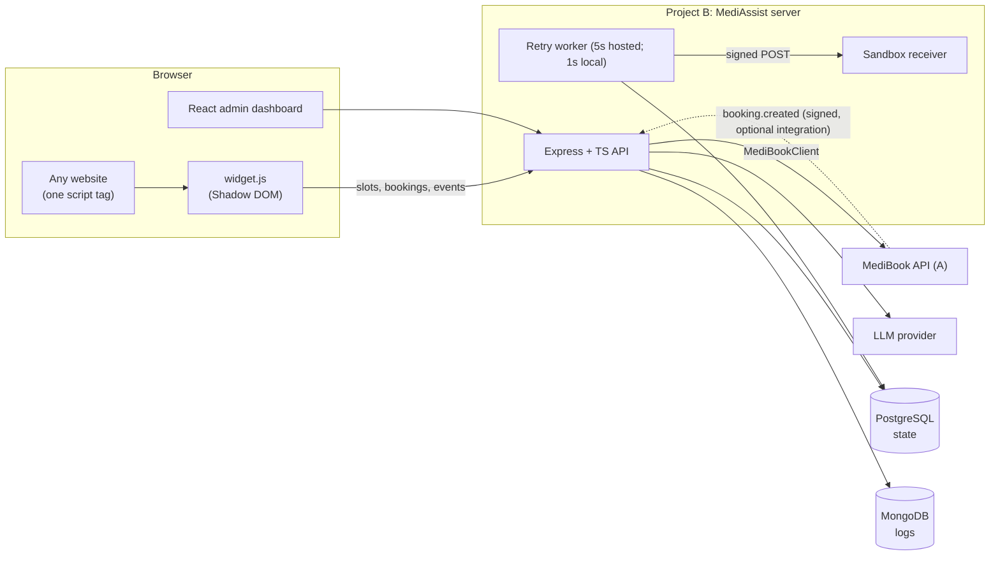

# MediAssist AI: Final Build Plan (v3)

**Execution:** iterative, completion-gated; the old overnight schedule is removed because it is no longer actionable.
**Local development:** Docker-free. The app runs against file-backed local storage and a local MediBook mock.
**Production backend:** production startup requires PostgreSQL, MongoDB, strong secrets, HTTPS integration URLs, and a real LLM configuration. The code implements migrations, shared rate limits, worker leases, idempotency, health checks, and graceful shutdown.
**Boundary:** this is a single-clinic-per-deployment backend. Live launch and permission to process real patient data still require the real MediBook contract, provider/hosting credentials, clinic data policy, and operational/security review; the repository does not claim HIPAA compliance.

---

## 1. Requirements → proof

| # | Requirement | Where it is proven (what a reviewer can click) |
|---|---|---|
| 1 | LLM API automation | Dashboard → Automations: run one, see tokens, latency, status; `booking.created` triggers it automatically |
| 2 | Third-party gateway/webhook sandbox | Dashboard → Webhook Sandbox: failure modes, signed deliveries, retries, replay |
| 3 | MongoDB logs | Dashboard → Log Viewer: filter by type/status, drill into one correlation ID across services |
| 4 | Service-to-service calls to A | `MediBookClient` (service key, timeout, retry, circuit breaker, `X-Request-Id`); every call in `service_call_logs` |
| 5 | LLM visit-note summarizer | Dashboard → Summarizer: raw note beside structured SOAP summary, PHI redacted before the LLM call |
| 6 | Embeddable booking widget (vanilla JS) | Live `demo.html` on a *different origin* with a single `<script>` tag |
| Stack | Express + TS + PostgreSQL + React | Whole repo |

---

## 2. Decisions locked (no more deliberating)

| Topic | Decision |
|---|---|
| Repo | One monorepo, pnpm workspaces: `server/`, `client/`, `widget/`, `mock-medibook/`, and `demo/` |
| Server | Express + TypeScript, Zod validation, `pg` (Postgres), Mongoose (Mongo), Pino, Helmet, PostgreSQL-shared production rate limits; file-backed local adapter when database URLs are absent |
| Client | Vite + React + TypeScript with a small API client and CSS |
| Widget | Vanilla JS, Shadow DOM, bundled with esbuild to one IIFE `widget.js` |
| LLM | `LLMProvider` interface with **one real provider** (whichever API key you have) **plus `MockProvider`**. Model name from env, never hardcoded. |
| Webhook retries | **State in Postgres, attempts in Mongo, leased DB-polling worker** (5 s in production; configurable faster local polling). Survives restarts and coordinates replicas without Redis. |
| Auth | Short-lived JWT with issuer/audience and revocable session version. Public key plus origin allowlist for the widget. Service key for B → A. |
| Hosting | Render (server) + Neon (Postgres) + Atlas (Mongo) + Vercel (client and demo page), documented as optional deployment targets. No credentials or live deployment are assumed. |
| CI | GitHub Actions for lint, typecheck, and build. Unit and local HTTP integration checks are part of delivery verification. |

---

## 3. Architecture



**Why state in Postgres and attempts in Mongo:** delivery status is a small state machine that needs transactional updates, while per-attempt logs are append-only, high-volume, and expire. This is a good interview answer.

---

## 4. Repo layout

```
mediassist/
├─ server/
│  ├─ sql/schema.sql
│  └─ src/
│     ├─ config/env.ts              # Zod-validated env
│     ├─ db/{store.ts,mongo.ts}
│     ├─ middleware/{correlationId,requestLogger,auth,publicKey,rateLimit,error}.ts
│     ├─ lib/{hmac,backoff,redact,circuitBreaker,logger}.ts
│     ├─ llm/{provider.ts,anthropic-or-openai.ts,mock.ts,schemas.ts}
│     ├─ modules/{auth,notes,automations,webhooks,sandbox,logs,medibook,public,events}/
│     ├─ worker/deliveryWorker.ts
│     └─ app.ts, index.ts
├─ client/                          # React dashboard
├─ widget/src/{index.js,ui.js,api.js,styles.css}
├─ mock-medibook/                   # local MediBook-compatible API
├─ demo/                            # separate-origin widget demo
├─ .github/workflows/ci.yml
├─ docs/DECISIONS.md                # jot a line per design decision as you build
└─ README.md
```

---

## 5. Block 0: establish the MediBook contract

The original external service A is not present in this workspace. Define and implement the contract against `mock-medibook` first; keep its base URL and service key configurable so a real MediBook API can replace it later. Record the actual request and response examples in `docs/A-contract.md`.

- [x] Define a stable local contract and document sample JSON in `docs/A-contract.md`.
- [ ] For a later real integration, confirm A's auth, CORS behavior, and webhook support; do not block local implementation on access to A.
- [x] Build `mock-medibook` with the same endpoints so local bookings work without external services.

**Widget routing:** widget → B `/public/*` → A. This keeps the service key server-side and works even when A has no browser CORS support.

**How B learns about `booking.created`**, in priority order:
1. A can send a signed webhook to B `POST /events/inbound` when integrated later.
2. The widget fires `POST B/public/events/booking-created {bookingId}`. B verifies the booking with A server-to-server before emitting the event.
3. Dashboard "Simulate booking.created" button remains available for demos.

---

## 6. Data model

**PostgreSQL (required in production; optional in development):**
- Persist named application collections as JSONB records in a keyed PostgreSQL table; local development uses an atomic file-backed adapter with the same repository API.
- Startup applies numbered migrations recorded in `schema_migrations`. The entries below describe logical records in `app_records`; this is not a normalized clinical database schema.
- The supported deployment boundary is one clinic per installation. Tenant isolation for multi-clinic SaaS is not implemented.
- `users(id, email, password_hash, role, created_at)`
- `visit_notes(id, redacted_text, summary jsonb, status[pending|completed|failed], error, provider, model, tokens_in, tokens_out, latency_ms, idempotency_key UNIQUE, correlation_id, created_at)`
  *(raw text is not stored by default; flag `STORE_RAW_NOTES=false`)*
- `prompt_templates(id, name, version, body, is_active)`
- `automations(id, name, trigger_event, template_id, enabled)`
- `automation_runs(id, automation_id, trigger_event, status, result jsonb, correlation_id, created_at)`
- `webhook_endpoints(id, url, secret, enabled, created_at)`
- `webhook_deliveries(id, endpoint_id, event_type, payload jsonb, status[pending|delivered|failed], attempts, next_attempt_at, last_error, created_at)`
- `api_keys(id, public_key UNIQUE, allowed_origins text[], clinic_id, enabled)`

**MongoDB** (all docs: `correlationId`, `ts`; **TTL index 14 days** on `ts`):
- `request_logs`: method, path, status, durationMs, userId
- `llm_logs`: provider, model, tokensIn, tokensOut, latencyMs, status, retries, errorCode
- `service_call_logs`: target, method, url, status, durationMs, attempt, breakerState
- `webhook_attempt_logs`: deliveryId, attempt, httpStatus, durationMs, error, signaturePrefix

**Log hygiene (a signal interviewers notice):** never log `Authorization`, secrets, or note text. Log lengths, IDs, and hashes only.

---

## 7. API surface

| Area | Endpoints | Auth |
|---|---|---|
| Auth | `POST /auth/login`, `GET /auth/me` | none / JWT |
| Notes | `POST /notes/summarize` (header `Idempotency-Key`), `GET /notes`, `GET /notes/:id` | JWT |
| Templates | `GET/POST /templates` | JWT |
| Automations | `GET/POST /automations`, `PATCH /automations/:id`, `POST /automations/:id/run`, `GET /automations/:id/runs` | JWT |
| Webhooks | `POST/GET /webhooks/endpoints`, `POST /webhooks/send-test`, `GET /webhooks/deliveries`, `POST /webhooks/deliveries/:id/replay` | JWT |
| Sandbox receiver | `POST /sandbox/receiver/:endpointId?mode=ok\|500\|timeout\|slow\|badsig` (verifies HMAC, logs, answers per mode) | signature |
| Events | `POST /events/inbound` (signed, from A), `POST /events/simulate` | signature / JWT |
| Logs | `GET /logs?type=&status=&correlationId=&from=&to=&page=&limit=` | JWT |
| MediBook (internal) | `GET /medibook/slots`, `POST /medibook/bookings` | JWT |
| Widget keys | `GET/POST /api-keys`, `PATCH /api-keys/:id` | JWT |
| Public (widget fallback) | `GET /public/slots`, `POST /public/bookings`, `POST /public/events/booking-created` | public key + origin allowlist + rate limit |
| Static | `GET /widget.js` (CORS `*`, `max-age=300`), `GET /docs` (OpenAPI), `GET /health` (pg + mongo status) | none |

---

## 8. Feature specs with a "minimum-complete" bar

### 8.1 LLM automation
- Provider client: 30 s timeout, up to 2 retries on 429/5xx with exponential backoff and jitter, captures tokens and latency, optional cost estimate from env prices.
- Output: strict JSON validated by Zod. On invalid JSON, **one repair retry**; otherwise `status=failed` with a stored error.
- `MOCK_LLM=true` returns a deterministic summary so the demo never depends on a key or network.
- **Minimum-complete:** an automation with a template runs on API call *and* on `booking.created`, with an `automation_runs` row and an `llm_logs` entry.

### 8.2 Webhook sandbox
- Signature header: `X-MediAssist-Signature: t=<unix>,v1=<hex HMAC-SHA256 of "t.body">`; 5-minute timestamp tolerance; `crypto.timingSafeEqual`.
- Backoff schedule: 5 s, 30 s, 2 m, 10 m, max 5 total attempts, jitter. Base is env-scalable (`WEBHOOK_BACKOFF_SCALE=0.05` for fast demos).
- Worker polls Postgres for due deliveries, sends, logs each attempt to Mongo, updates state.
- Replay creates a fresh attempt chain for a delivery.
- **Minimum-complete:** create endpoint, send test with `mode=500`, watch retries, switch to `mode=ok`, replay, see `delivered`.

### 8.3 MongoDB logging
- Middleware assigns or accepts `X-Request-Id`, attaches it to every log doc and every outbound call (LLM, A, webhooks).
- **Minimum-complete:** one booking flow produces request, service-call, llm, and webhook-attempt docs sharing one correlation ID, and the Log Viewer shows them as a timeline. Local mode uses JSONL logs; MongoDB uses a 14-day TTL index.

### 8.4 Service-to-service (B → A)
- `MediBookClient`: base URL and service key from env, 5 s timeout, 2 retries on network/5xx (never on 4xx), circuit breaker (open after 5 consecutive failures, half-open after 30 s), propagates `X-Request-Id`, logs every attempt.
- **Minimum-complete:** slots and bookings fetched through B; transient failures retry, 4xx errors stop, and repeated failures open the breaker.

### 8.5 Visit-note summarizer
- Flow: validate → **redact** → build prompt from template → LLM → Zod-validate → store.
- Redaction (regex, best effort): emails, phones, SSN-like IDs, DOB patterns, MRN patterns, and `Patient:` label names. **README states plainly that this is best-effort redaction, not HIPAA compliance.**
- Summary schema: `{subjective, objective, assessment, plan, followUps[], flags[]}`.
- Idempotency: same `Idempotency-Key` returns the stored result and does not call the LLM again.
- **Minimum-complete:** paste a note in the dashboard, get a stored structured summary, resubmit with the same key and get the identical result instantly.

### 8.6 Embeddable booking widget
```html
<script src="https://YOUR-HOST/widget.js" data-key="pk_live_xxx" data-clinic="1"></script>
```
- Optional attributes: `data-api`, `data-mount="#selector"` (inline mode), `data-color`.
- No `data-mount`: floating launcher button plus panel. All DOM inside a **Shadow DOM**, so host-page CSS cannot leak in or out.
- Flow: pick date → load slots → name/email/phone → confirm → success or error.
- Accessibility: labelled inputs, `aria-live` status region, focus moved into the panel on open and restored on close, Esc closes, full keyboard path.
- States: loading, empty (no slots), validation errors, network error with retry, double-submit guard.
- Bundle target under 30 KB minified. Built to `server/public/widget.js`.
- **Minimum-complete:** a plain HTML page on another origin books a real slot with one script tag.

---

## 9. The demo story

1. Open the separate-origin local demo → widget loads from the API → book a slot. Hosting can be configured later.
2. `booking.created` fires → automation runs → LLM pre-visit summary is generated.
3. Outbound webhook goes to the sandbox receiver in `mode=500` → watch retries → flip to `ok` → replay → delivered.
4. In the Log Viewer, paste one correlation ID → see the whole chain across widget request, A call, LLM call, and webhook attempts.
5. Summarizer page: paste a messy note with PHI → redacted input beside structured output.

---

## 10. Completion gates

| Gate | Completion evidence |
|---|---|
| Local foundation | One documented command starts the API, dashboard, demo origin, and MediBook mock without Docker. Health reports storage modes and login works. |
| Integrations | MediBook calls include retries, breaker state, and a shared correlation ID in logs. |
| LLM features | Mock mode works without credentials; an optional configured provider returns validated summaries; duplicate idempotency keys reuse stored results. |
| Webhooks/events | A simulated booking runs its automation and creates a signed delivery; failure, retry, success, and replay are available in the UI. |
| Widget | The standalone demo page on a separate local origin can book through one script tag. |
| Dashboard/docs | Login, bookings, summarizer, automations, webhook sandbox, and log timeline use the API; README documents startup and deploy configuration. |

**Deployment:** document provider-ready environment variables, but do not claim a live deployment without the user's hosting credentials and target accounts.

---

## 11. If you fall behind: cut order (features stay)

When scope needs to be reduced, preserve the six feature bars and cut in this order:

1. Dashboard visual polish (plain styling is fine; the screens must still work)
2. Merge the Bookings screen into the Log Viewer's service-call view
3. OpenAPI: document only the main routes (summarize, automations, webhooks, logs, public)
4. Extra prompt-template editing controls beyond create and activate
5. Cost estimation in `llm_logs`

**Never cut:** any of the six features, local startup, the README, or the demo page. Live hosting remains optional until credentials and accounts are available.

---

## 12. Verification and production acceptance

- Unit tests cover redaction, HMAC validation, encryption, retry timing, circuit breaking, production configuration, webhook destination policy, redirect handling, local storage uniqueness/leases/retention, rate-limit windows, and event payload filtering.
- The HTTP integration smoke test covers local startup surfaces, auth, widget keys/origins, MediBook booking and idempotency, note redaction and idempotency, event deduplication/conflict handling, webhook failure/retry/replay, and correlated log hygiene.
- Run `pnpm typecheck`, `pnpm lint`, `pnpm build`, `pnpm test:unit`, and `pnpm test:integration` before delivery.
- PostgreSQL and MongoDB migrations, transactions, TLS, shared quotas, failover, backups, and restoration still need verification against provisioned production-like services.

### Code readiness versus live launch

| Backend control | Code state | External acceptance still needed |
|---|---|---|
| Fail-closed production configuration | Implemented | Set and rotate hosting secrets |
| PostgreSQL schema/migrations and shared rate limits | Implemented | Run against managed PostgreSQL; backup and restore drill |
| MongoDB TLS, indexes, TTL, fail-closed startup | Implemented | Run against managed MongoDB; validate monitoring/retention |
| Admin session expiry and password rotation | Implemented | Configure actual initial operator account |
| HTTPS MediBook and outbound webhook safeguards | Implemented against the mock/local receiver | Confirm real MediBook contract, credentials, webhook signing and retry semantics |
| Real LLM provider path | Implemented for OpenAI-compatible APIs | Configure an approved provider contract and credentials; validate data handling and output quality |
| Single-clinic authorization boundary | Explicitly documented | Validate clinic access requirements and policies |
| Legal/security/compliance operations | Not provided by this codebase | Complete organizational review; no compliance claim is made |

---

## 13. Security and privacy notes

- JWT secret, service key, and LLM keys only in env; `.env` gitignored, `.env.example` committed.
- Helmet, exact configured CORS origins for admin routes, PostgreSQL-shared production limits for login, inbound events, widget calls, and summarization.
- Origin allowlist is **abuse control, not authentication** (non-browser clients can spoof `Origin`), and the README should say so.
- Generated webhook secrets are stored encrypted with the endpoint, returned once on creation, and never written to logs. Set `WEBHOOK_ENCRYPTION_KEY` in the environment and preserve it across restarts.
- Logs store metadata only (no note text, no auth headers); MongoDB TTL is 14 days.
- Note and event idempotency keys are scoped/hashed and payload-bound. Event automation payloads omit common sensitive fields and are redacted before LLM calls.
- Outbound webhook URLs require HTTPS, resolve only to public addresses, are pinned to a resolved address, and do not follow redirects.
- Redaction is best-effort and is **not** a compliance claim. Review data handling, access, backups, retention, provider contracts, and incident response before real patient data is used.

---

## 14. Env vars

```
NODE_ENV, PORT, DATA_DIR
DATABASE_URL (required in production; file-backed local state when unset)
MONGO_URL (required in production; local JSONL logs when unset)
DB_POOL_MAX, DB_CONNECT_TIMEOUT_MS, TRUST_PROXY_HOPS, JSON_BODY_LIMIT
JWT_SECRET, WEBHOOK_ENCRYPTION_KEY, ADMIN_EMAIL, ADMIN_PASSWORD
MEDIBOOK_BASE_URL, MEDIBOOK_SERVICE_KEY
LLM_PROVIDER, LLM_API_KEY, LLM_MODEL, MOCK_LLM
LLM_PRICE_IN_PER_MTOK, LLM_PRICE_OUT_PER_MTOK     (optional)
STORE_RAW_NOTES=false
WEBHOOK_BACKOFF_SCALE=1
CORS_ADMIN_ORIGIN, PUBLIC_BASE_URL
MEDIBOOK_PORT, WEBHOOK_POLL_MS, WEBHOOK_BACKOFF_SCALE, VITE_API_BASE_URL
```

---

## 15. Portfolio kit

**Blurb (edit freely):**
> MediAssist AI is a full-stack clinic integrations platform built against a MediBook-compatible API. It summarizes visit notes into structured SOAP summaries with PHI redaction and idempotent LLM calls, ships a one-script-tag Shadow DOM booking widget, and includes a webhook sandbox with HMAC-signed deliveries, exponential-backoff retries, and replay. Correlation IDs connect request, LLM, service, and webhook logs in MongoDB or local JSONL mode. Built with Express, TypeScript, PostgreSQL, MongoDB, and React.

**Resume bullets (add your own measured numbers after testing):**
- Built an LLM visit-note summarizer with Zod-validated structured output, PHI redaction, retry/repair logic, and idempotency keys.
- Designed a webhook delivery system with HMAC-SHA256 signatures, DB-backed retry worker, exponential backoff, and replay.
- Implemented cross-service tracing with correlation IDs across Postgres-backed state and MongoDB logs with TTL retention; added a circuit-breaker client for service-to-service calls.
- Shipped an embeddable, accessible booking widget (Shadow DOM, vanilla JS, under 30 KB) that works on any site via one script tag.

**Interview questions to prepare (the answers are your `docs/DECISIONS.md`):**
1. Why idempotency keys on the summarizer, and what happens on a duplicate?
2. Why HMAC with a timestamp, and what stops replay attacks?
3. Why is delivery state in Postgres but attempts in Mongo?
4. How does your retry worker behave if the server restarts mid-retry?
5. What does your circuit breaker do, and when would it hurt?
6. What are the limits of your redaction, and what would you do for production?
7. Why Shadow DOM, and what are its tradeoffs?
8. Is the origin allowlist secure? (Answer: no, it limits abuse only.)

---

## 16. Delivery checklist

- [x] Local demo page (different origin) books a slot with one script tag (HTTP integration smoke test)
- [ ] Fresh-clone setup is Docker-free and documented
- [x] CI workflow runs typecheck, lint, build, and unit tests
- [x] Demo-only login credentials are documented; production startup requires explicit credentials
- [x] `MOCK_LLM=true` documented for reviewers without a key
- [x] README: pitch, Mermaid diagram, run-locally, design decisions, security notes, and API docs link
- [ ] Optional portfolio follow-up: capture dashboard/log screenshots or a GIF and add live links after deployment
- [ ] No secrets in git history (`git log -p | grep -i key` sanity check)
- [x] Production deployment requirements and health-check instructions are documented without claiming a live service

---

## 17. Implementation workflow

Build each subsystem against the local mock and file-backed adapter first. Keep integration boundaries configurable, make the local demo reproducible from a clean checkout, and record any contract or security decisions in `docs/DECISIONS.md` as they are made.
